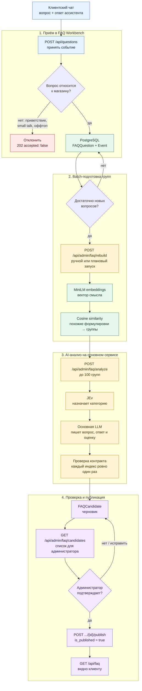

# Жизненный цикл FAQ

Документ описывает фактический поток от сообщения клиента до опубликованного
ответа FAQ. В проекте участвуют два сервиса:

- **FAQ Workbench** на порту `8010` принимает события из чата, хранит вопросы,
  строит семантические группы и хранит черновики кандидатов.
- **Основной AI-сервис** на порту `8000` классифицирует группы и готовит текст
  будущего FAQ через `POST /api/admin/faq/analyze`.

FAQ Workbench не публикует ответ автоматически. Публикация — отдельное действие
администратора после проверки черновика.

## Карта URL-ручек

В таблице хост `AI` означает основной сервис (`http://localhost:8000`), а
`WB` — FAQ Workbench (`http://localhost:8010`). Эти сервисы имеют одинаковые
части пути `/api/admin/faq`, но это разные приложения и разные ключи доступа.

| Сервис | Метод и URL                               | Доступ                  | Назначение                                                                                                                                                                                            |
| ------------ | ----------------------------------------------- | ----------------------------- | --------------------------------------------------------------------------------------------------------------------------------------------------------------------------------------------------------------- |
| AI           | `GET /health`                                 | публичный            | Проверяет, что процесс отвечает и доступна БД, если она настроена                                                                                         |
| AI           | `GET /ready`                                  | публичный            | Проверяет наличие ключей и настроек обеих моделей; возвращает `503`, если сервис не готов                                               |
| AI           | `POST /api/chat`                              | Origin + rate limit           | Обычный ответ клиентского ассистента                                                                                                                                           |
| AI           | `POST /api/chat/stream`                       | Origin + rate limit           | Потоковый ответ через SSE                                                                                                                                                                    |
| AI           | `WS /api/chat/ws`                             | Origin                        | Долгоживущий WebSocket для нескольких ходов чата                                                                                                                              |
| AI           | `POST /api/admin/faq/analyze`                 | `X-Admin-Key`               | Принимает до 100 групп вопросов, вызывает JEv и основную LLM, возвращает проверенный FAQ-анализ                                             |
| WB           | `POST /api/questions`                         | разрешённый Origin | Принимает вопрос и ответ ассистента, применяет фильтр, сохраняет событие и запускает фоновую проверку batch-порога |
| WB           | `GET /api/faq`                                | публичный            | Возвращает только опубликованные FAQ для клиентского интерфейса                                                                                           |
| WB           | `POST /api/admin/faq/rebuild`                 | `X-FAQ-Admin-Key`           | Вручную запускает или принудительно повторяет batch-анализ; строит embeddings и кандидатов                                                      |
| WB           | `GET /api/admin/faq/questions`                | `X-FAQ-Admin-Key`           | Показывает накопленные уникальные вопросы и частоты событий                                                                                                |
| WB           | `GET /api/admin/faq/candidates`               | `X-FAQ-Admin-Key`           | Показывает черновики кандидатов, их категории, оценки, ответы и источники                                                                         |
| WB           | `POST /api/admin/faq/candidates/{id}/publish` | `X-FAQ-Admin-Key`           | Переводит проверенный кандидат в опубликованное состояние                                                                                                   |
| WB           | `DELETE /api/admin/faq/candidates/{id}`       | `X-FAQ-Admin-Key`           | Снимает кандидата с публикации, не удаляя историю вопросов                                                                                                    |

### Подробно по шагам

#### 1. `WB POST /api/questions`

Тело запроса содержит `question`, необязательные `answer`, `conversation_id` и
идемпотентный `event_id`. Ответ `202` означает, что событие принято или уже
было принято ранее. Поле `accepted: false` означает, что сообщение отфильтровано
до БД; это не ошибка HTTP.

Фоновая задача после успешной записи вызывает внутреннюю логику rebuild. Вызов
не ждёт завершения LLM и не возвращает кандидатов в ответе на этот POST.

#### 2. `WB GET /api/admin/faq/questions`

Возвращает агрегированные сырые данные Workbench:

```json
{
  "total_events": 42,
  "items": [
    {"question": "Как подключить камеру?", "frequency": 7}
  ]
}
```

Это endpoint диагностики накопления. Он не показывает категории и не означает,
что вопрос уже прошёл AI-анализ.

#### 3. `WB POST /api/admin/faq/rebuild`

Параметры запроса:

- `limit` — максимум исходных вопросов/групп, от 1 до 100;
- `force=true` — игнорировать обычный порог и интервал;
- без `force` запуск возможен только при достаточном числе новых вопросов или
  после заданного интервала.

Возможные статусы результата: `skipped`, `in_progress`, `completed`. При
`completed` ответ содержит число исходных вопросов, число семантических групп и
сохранённых кандидатов.

#### 4. `AI POST /api/admin/faq/analyze`

Это единственная ручка в описанном потоке, которая вызывает генеративные модели.
Workbench передаёт ей уже сгруппированные вопросы. AI-сервис:

1. JEv назначает категорию каждому индексу;
2. основная LLM группирует формулировки внутри категорий и пишет черновик;
3. сервис проверяет, что каждый индекс покрыт ровно один раз;
4. ответ возвращается Workbench в виде `FAQAnalysisResponse`.

Ошибку или перегрузку модели AI-сервис возвращает как `503`/`502`; Workbench не
должен считать такой batch успешно завершённым.

#### 5. `WB GET /api/admin/faq/candidates`

Возвращает рабочие черновики. Важные поля кандидата:

| Поле             | Смысл                                                                                                              |
| -------------------- | ----------------------------------------------------------------------------------------------------------------------- |
| `id`               | Идентификатор для publish/delete                                                                        |
| `category`         | Категория, назначенная JEv и проверенная схемой                                   |
| `question`         | Нормализованная формулировка группы                                                    |
| `answer`           | Ответ из контекста и/или модели; требует проверки администратора |
| `frequency`        | Суммарная частота исходных вопросов                                                     |
| `score`            | Полезность для FAQ от 0 до 100                                                                         |
| `priority`         | `высокий`, `средний`, `низкий` или `проверить`                                  |
| `source_questions` | Исходные формулировки, на которых основан кандидат                          |
| `published`        | Текущий статус публикации                                                                        |

#### 6. `WB POST /api/admin/faq/candidates/{id}/publish`

После проверки администратор вызывает эту ручку. Она меняет только флаг
публикации кандидата. Генерации нового ответа в этот момент нет. Если кандидат
не найден, возвращается `404`; если ответ пустой, сервис должен вернуть `422`.

#### 7. `WB GET /api/faq`

Публичная ручка читает только записи с `is_published = true`. Черновики,
отфильтрованные вопросы и кандидаты на проверке в этот ответ не попадают.

#### 8. `WB DELETE /api/admin/faq/candidates/{id}`

Снимает FAQ с публикации. Это обратимое административное действие: исходные
вопросы, частоты и события остаются в базе и могут попасть в следующий rebuild.

#### 9. `AI GET /ready` и `AI GET /health`

Перед интеграционным прогоном сначала проверяйте `/health`, затем `/ready`.
`/health` отвечает за доступность процесса и БД, а `/ready` — за наличие
`LLM_API_KEY`, `JEV_LLM_API_KEY`, моделей и `ADMIN_API_KEY`. Успешный `/health`
не доказывает, что вызов модели пройдёт.

## Общая схема



## 1. Приём события

Фронтенд отправляет Workbench `POST /api/questions` после ответа ассистента:

```json
{
  "event_id": "a7a14b70-a9a4-43c8-a9d4-a883367ae43e",
  "conversation_id": "chat-session-id",
  "question": "Работает ли сигнализация без интернета?",
  "answer": "Для этой модели нужен GSM или Wi-Fi канал."
}
```

`event_id` должен повторяться при сетевом retry. Повтор этого идентификатора не
создаёт второе обращение. Для endpoint требуется разрешённый браузерный `Origin`.

### Входной фильтр

До записи выполняются следующие проверки:

1. Маскируются email и телефоны.
2. Приветствия и короткий small talk отклоняются с причиной `greeting_only`.
3. Явно посторонние темы (например, погода или фильмы) отклоняются с причиной
   `no_platform_signal`.
4. В самом вопросе должен быть признак товара, устройства, настройки, доставки,
   оплаты или другой темы магазина. Слова только в `answer` недостаточно: ответ
   ассистента не может превратить посторонний вопрос в FAQ.

Отклонённое событие получает HTTP `202` и JSON с `accepted: false`; в PostgreSQL
оно не сохраняется и в batch-анализ не попадает.

## 2. Что сохраняется в PostgreSQL

Для принятого события используются две связанные записи.

| Таблица          | Назначение                                                                                                                                                      |
| ----------------------- | ------------------------------------------------------------------------------------------------------------------------------------------------------------------------- |
| `faq_question_events` | Идемпотентный факт получения `event_id`, связь с диалогом и временем                                                   |
| `faq_questions`       | Уникальная нормализованная формулировка, исходный текст, частота, контексты ответов и embedding |

Повтор уже известной формулировки увеличивает `occurrence_count` и добавляет
контекст ответа, но не создаёт вторую строку вопроса. PII не передаётся в модель
и не сохраняется в исходном виде.

## 3. Batch-анализ

После успешной записи Workbench запускает фоновую проверку порога. Анализ начинается,
когда накоплено нужное количество новых уникальных вопросов и выдержан минимальный
интервал с прошлого запуска. Lease в `faq_analysis_state` не даёт двум процессам
одновременно пересобирать кандидатов.

### Локальные embeddings

Workbench локально строит embedding для каждого вопроса моделью
`sentence-transformers/paraphrase-multilingual-MiniLM-L12-v2` через FastEmbed.
Эта модель не пишет FAQ и не назначает категорию. Она нужна только для оценки
семантической близости формулировок.

### Семантические группы

Вопросы объединяются по cosine similarity. Частота группы складывается из частот
входящих вопросов, а исходные варианты сохраняются как источники. В AI-сервис
передаётся не более 100 групп, каждая с индексом, частотой, вариантами и
`answer_context`.

## 4. AI-анализ группы

Workbench вызывает защищённый endpoint основного сервиса:

```http
POST http://api:8000/api/admin/faq/analyze
X-Admin-Key: <ADMIN_API_KEY>
```

Основной сервис выполняет два последовательных этапа в
[`faq_analyzer.py`](../app/agents/faq_analyzer.py):

### Этап A — категория через JEv

`classify_questions` вызывает TypeSafe JEv и назначает каждому исходному индексу
ровно одну категорию:

- `подбор и покупка`;
- `характеристики и совместимость`;
- `монтаж и настройка`;
- `эксплуатация и неисправности`;
- `гарантия и обслуживание`;
- `доставка и оплата`;
- `прочее`.

Если классификатор завершился ошибкой, используется безопасный fallback
`прочее` для всех входных вопросов, а в лог пишется
`faq.classification_fallback`.

### Этап B — текст через основную LLM

`write_text` передаёт основной модели вопросы, назначенные категории и контекст
ответов. Модель должна вернуть структурированный `FAQTextDraft`:

- краткий общий вопрос;
- индексы исходных вопросов;
- оценку полезности `0..100`;
- обоснование;
- ответ только на основании `answer_context`.

Если модель отказала или недоступна, создаётся отдельная группа на вопрос с
пустой оценкой и ручной проверкой. Ответ из входного контекста может быть
сохранён как проверенный контекст; новый факт модель не придумывает.

### Объединение и защита индексов

Категория берётся из JEv, даже если текстовая модель вернула другую категорию.
Смешанная группа разделяется по категориям. Затем сервис проверяет, что каждый
исходный индекс встречается ровно один раз. Потерянные моделью вопросы добавляются
как отдельные элементы с приоритетом `проверить`.

## 5. Кандидат FAQ

После успешного ответа AI-сервиса Workbench удаляет старые неопубликованные
черновики и создаёт новые `FAQCandidate`.

Кандидат содержит:

- категорию;
- нормализованный вопрос;
- подготовленный ответ;
- суммарную частоту;
- оценку FAQ и приоритет;
- rationale модели;
- список исходных вопросов и их идентификаторы;
- `is_published = false`.

Посмотреть кандидатов:

```bash
curl http://localhost:8010/api/admin/faq/candidates \\
  -H "X-FAQ-Admin-Key: $FAQ_ADMIN_API_KEY"
```

Кандидат — это рабочий черновик. Его наличие не означает, что ответ виден
клиентам.

## 6. Проверка и публикация

Администратор проверяет формулировку, категорию, источники и ответ. Публикация
возможна только если ответ непустой:

```bash
curl -X POST \\
  http://localhost:8010/api/admin/faq/candidates/<ID>/publish \\
  -H "X-FAQ-Admin-Key: $FAQ_ADMIN_API_KEY"
```

После этого у кандидата устанавливается `is_published = true`. Публичный список
берётся через:

```bash
curl http://localhost:8010/api/faq
```

Снятие публикации не удаляет источник или историю вопроса:

```bash
curl -X DELETE \\
  http://localhost:8010/api/admin/faq/candidates/<ID> \\
  -H "X-FAQ-Admin-Key: $FAQ_ADMIN_API_KEY"
```

## 7. Наблюдаемость и диагностика

Для одного batch-запроса нужно искать общий `request_id` в логах основного API.
Успешный проход выглядит так:

1. `faq.classification_started` — указаны `typesafe` и модель JEv.
2. HTTP `200` от TypeSafe endpoint.
3. `faq.classification_completed`.
4. `faq.text_generation_started` — указаны провайдер и модель основной LLM.
5. HTTP `200` от провайдера основной модели.
6. `faq.text_generation_completed`.
7. HTTP `200` у `/api/admin/faq/analyze`.

Fallback-события `faq.classification_fallback` и
`faq.text_generation_fallback` означают, что соответствующая модель не дала
полный результат. В этом случае кандидат остаётся доступным для ручной проверки,
но его нельзя считать подтверждённым ответом модели.

## 8. Частые причины расхождений

- Старые приветствия в `/api/admin/faq/candidates` — это исторические записи,
  созданные до исправления входного фильтра; новый фильтр их не удаляет.
- Принятый вопрос ещё не означает вызов модели: до порога он только хранится в
  Workbench.
- Локальная MiniLM и генеративная LLM решают разные задачи: первая группирует,
  вторая классифицирует и формулирует черновик.
- Публикация кандидата и наличие FAQ в prompt ассистента — отдельные операции;
  опубликованный Workbench FAQ должен быть передан в управляемые FAQ основного
  ассистента интеграционным слоем.
